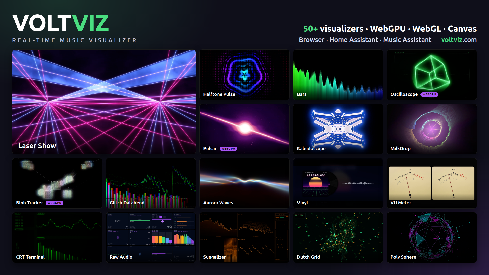
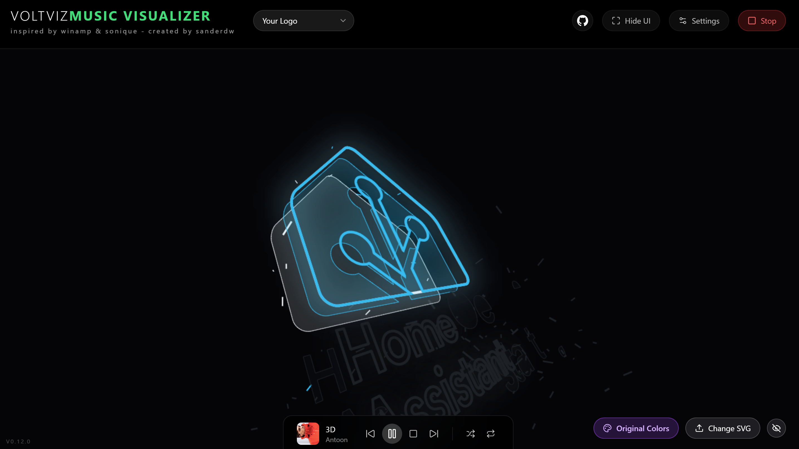

# VoltViz

A real-time music visualizer for the browser. It reacts to your microphone, your system audio, or a [Music Assistant](https://music-assistant.io) player through [Sendspin](https://www.sendspin-audio.com).

[](https://voltviz.com)

## Run VoltViz

Pick one:

- **In the browser**: open [voltviz.com](https://voltviz.com) and choose **Microphone** or **System Audio**. To see it with music straight away, open the [demo Sendspin server](https://voltviz.com/?sendspin=https://sendspin-demo.voltviz.com) and click **Connect**.
- **In Home Assistant**: add the [VoltViz App repository](https://github.com/sanderdw/hassio-addons) and install the App.

  [](https://my.home-assistant.io/redirect/supervisor_add_addon_repository/?repository_url=https%3A%2F%2Fgithub.com%2Fsanderdw%2Fhassio-addons)
- **With Docker**: run the image and open `http://localhost:8080`.

  ```bash
  docker run --rm -p 8080:80 ghcr.io/sanderdw/voltviz:latest
  ```

To run it from source, see [CONTRIBUTING.md](CONTRIBUTING.md).

## Visualizers

The picker holds more than 50 visualizers: particle fields (Cosmic Particles, Fireworks Show), 3D scenes (Poly Sphere, Hex Globe, Kaleidoscope), retro screens (CRT Terminal, VU Meter, MS Defrag), festival stages (Defqon Mainstage, Laser Show), MilkDrop-inspired feedback, WebGPU pieces (Pulsar, Daybreak), and visualizers that show the playing track's artwork or your own logo. Shuffle switches between them at an interval.

The interface itself comes in four skins: Modern, Win95, Winamp and CRT (see the [`skin` parameter](#url-parameters)).

## How to connect Music Assistant



1. Click **Sendspin** in the header.
2. Enter the URL of your Sendspin server, for example `http://homeassistant.local:8927`. `ws://` and `wss://` URLs work too.
3. Click **Connect**. VoltViz appears as a player in Music Assistant; play music on it.

To skip step 2, put the server in the link. The dialog opens with the URL filled in:

```
http://localhost:8080/?sendspin=http://homeassistant.local:8927
```

No Music Assistant at hand? `uvx sendspin serve --demo` starts a demo server.

Check the [version requirements](#requirements) if the connection closes right away, and [Troubleshooting](#troubleshooting) if the server cannot be reached.

## How to link to a visualizer and its settings

The address bar follows what you do: pick a visualizer or change a setting and the URL updates, leaving out settings that are still at their default. Copy it to share or bookmark that setup.

You can also write such a link by hand with the [URL parameters](#url-parameters):

```
http://localhost:8080/?viz=tunnel&sensitivity=1.5&speed=2.0&hueShift=180&scale=1.2
```

Add `sendspin` to have the same link open the connect dialog: `/?sendspin=http://homeassistant.local:8927&viz=vinylsendspin&hueShift=90`

## Troubleshooting

**A WebGPU visualizer shows *WebGPU not available*.** Browsers turn WebGPU off on plain-http pages. Open VoltViz over `https://` or on `localhost`, in a recent Chrome, Edge or Safari. This affects a self-hosted VoltViz or Home Assistant opened at an `http://` address such as `http://homeassistant.local:8123`. The other visualizers still work there.

**Sendspin does not connect from voltviz.com.** A page loaded over `https://` may not connect to an `http://` server (mixed content), and most local Sendspin servers are plain http. Run VoltViz [with Docker](#run-voltviz) on the same network and open it over `http://`, so both sides match: Home Assistant at `http://homeassistant.local:8123` goes with Sendspin at `http://homeassistant.local:8927`.

## Reference

### URL parameters

| Parameter | Description | Default |
|-----------|-------------|---------|
| `viz` | Visualizer id (e.g. `tunnel`, `polysphere`, `fractalorb`) | `halftonepulse` |
| `sensitivity` | Audio reactivity multiplier (0.1–3.0) | `1.0` |
| `speed` | Animation speed multiplier (0.1–3.0) | `1.0` |
| `hueShift` | Color shift in degrees (0–360) | `0` |
| `scale` | Element scale multiplier (0.5–3.0) | `1.0` |
| `skin` | Interface skin: `modern`, `win95`, `winamp` or `crt` | `modern` |
| `agc` | `1` enables Auto Gain (normalizes quiet inputs such as a microphone) | off |
| `aibeat` | `1` enables AI Beat Tracking (keeps beat effects on the beat; uses extra CPU) | off |
| `style` | Music style for the beat tracking: `electronic` (house, techno, trance), `hard` (hardstyle, hardcore), `bass` (dubstep, drum & bass, trap: half-time pulse), `hiphop`, `band` (rock, pop, live band), `chill` (acoustic, ballads) | `auto` |
| `shuffle` | `1` switches to a random visualizer at an interval | off |
| `shuffleTime` | Shuffle interval in seconds: `15`, `30`, `60`, `120`, `300` or `600` | `60` |
| `shufflePool` | Comma-separated visualizer ids to shuffle between | all |
| `transition` | How visualizers switch: `crossfade`, `quickcut` or `instant` | `crossfade` |
| `sendspin` | Sendspin server URL; opens the connect dialog with it filled in | none |

### Playback controls

With a Sendspin server connected, a bar at the bottom controls the player:

- **Now playing**: artwork, title, artist and album. Without a track it says **Nothing playing** and where to start music.
- **Status**: *Paused*, *Stopped* or *Reconnecting (n/10)…*.
- **Progress**: elapsed and total time, or **LIVE** for a radio stream. It can be dragged to seek when the server supports seeking.
- **Transport**: previous, play/pause, stop and next, volume and mute, shuffle and repeat.
- **Hide**: the tab on top of the bar slides it down, leaving the tab with the current title. Clicking the tab brings the bar back.

In the [Home Assistant App](https://github.com/sanderdw/hassio-addons), opened from the Home Assistant sidebar, VoltViz also uses Music Assistant's own API. That adds:

- **Start**: with an empty queue, a list of your playlists (favorites first), recently played items and a library search. Play on an empty queue opens the same list.
- **Queue**: the current and upcoming tracks. Tapping one plays it.
- **Favorite**: a heart that adds the current track to your Music Assistant favorites.

These three are not available on voltviz.com, in Docker or on the App's direct port.

### Requirements

| For | You need |
|-----|----------|
| WebGPU visualizers | A recent Chrome, Edge or Safari 26+, and a page on `https://` or `localhost` |
| Music Assistant | Version 2.10.7 or newer. Older versions close the connection during the handshake |
| The `sendspin` CLI demo server | Version 9.1 or newer |

VoltViz uses `@sendspin/sendspin-js` 6.x, which speaks the encrypted Sendspin protocol of `aiosendspin` 10.x.

## How it works

One audio engine analyzes the sound on the audio thread: spectra, levels, kick, snare and hi-hat onsets, and the tempo. Every visualizer receives the same analysis each frame and draws it with Three.js, Canvas or WebGPU.

Beat effects fire only on beats that are actually heard: a kick or snare on the tracked beat grid, about 20 ms after the hit. They stop as soon as the drums stop, and a beat strength scales them, so a build-up without a drum hit stays calm. When a new song starts, the engine looks for the beat again.

Two settings change how the beat is found. **Music style** (Auto by default) adapts the tempo range to the genre and lets half-time music such as dubstep flash on the kick and snare instead of twice as fast. **AI Beat Tracking** runs a small neural network locally in the browser; it keeps the grid on the beat rather than the off-beat and finds the first beat of each bar.

More depth:

- [How VoltViz hears the beat](docs/explainer/how-voltviz-hears-the-beat.html): an animated walk-through of the engine and its settings.
- [Audio engine report 0.30.0](docs/reports/audio-engine-report-0.30.0.html): how well the beat detection works, measured per genre. The [0.23.0 report](docs/reports/audio-engine-report.html) covers the engine rewrite.
- [AI as audio engineer](docs/presentation/ai-as-audio-engineer.html): a conference talk on the rewrite (press `?` for keys).

These are HTML files; download or clone the repository and open them in a browser.

## Contributing

Contributions are welcome: new visualizers, performance work, bug fixes and docs. [CONTRIBUTING.md](CONTRIBUTING.md) covers setup, the checks to run, the project structure and how images are built. Report security issues as described in [SECURITY.md](SECURITY.md).

## License and credits

MIT © 2026 VoltViz Contributors, see [LICENSE](LICENSE). Some visualizer shaders keep their own (non-commercial) license.

Thanks to [@sabosugi](https://x.com/sabosugi) for the visuals, [imoss](https://github.com/ledhieu/imoss) by ledhieu for the Moss Ball shaders, kuvkar for the Flame shader, and JKU Linz for the [Beat This!](https://github.com/CPJKU/beat_this) model behind AI Beat Tracking. Full credits and licenses: [THIRD_PARTY_NOTICES.md](THIRD_PARTY_NOTICES.md).
